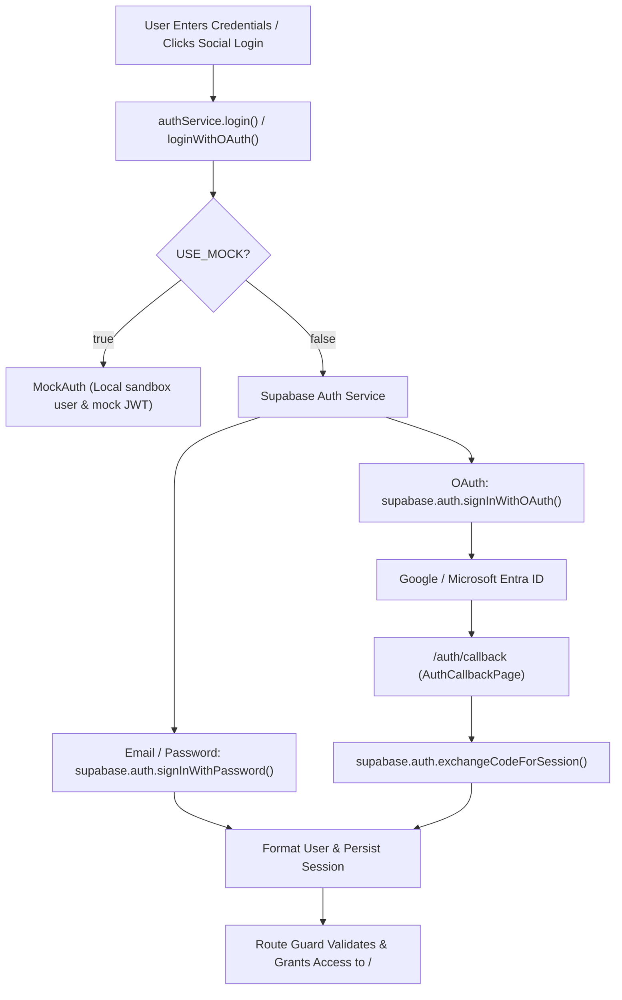

# Intellistrata Community Portal

> Modern, responsive, and cross-platform Community Portal for strata residents, committee members, and building managers. Built with **React 18**, **Framework7 v9**, **Vite**, **Capacitor 8**, and **Supabase Authentication**.

---

## Table of Contents

- [1. Project Overview & Architecture](#1-project-overview--architecture)
- [2. Authentication & Authorization (Deep Dive)](#2-authentication--authorization-deep-dive)
  - [2.1 Architecture & Principles](#21-architecture--principles)
  - [2.2 Supported Authentication Methods](#22-supported-authentication-methods)
  - [2.3 Route Protection & Session Lifecycle](#23-route-protection--session-lifecycle)
  - [2.4 Role-Based Access Control (RBAC)](#24-role-based-access-control-rbac)
- [3. Database & Backend Integration](#3-database--backend-integration)
  - [3.1 Separation of Concerns & Schema Ownership](#31-separation-of-concerns--schema-ownership)
  - [3.2 Supabase Auth Schema (`auth.users`)](#32-supabase-auth-schema-authusers)
  - [3.3 Migrations & Seed Scripts](#33-migrations--seed-scripts)
  - [3.4 Internal Backend API Contract (LiveAPI)](#34-internal-backend-api-contract-liveapi)
- [4. Completed Application Modules](#4-completed-application-modules)
- [5. Environment Configuration](#5-environment-configuration)
- [6. Running & Building the Application](#6-running--building-the-application)

---

## 1. Project Overview & Architecture

The **Intellistrata Community Portal** is designed as a single codebase delivering a high-performance web application as well as iOS and Android native containers through Capacitor.

### Core Technology Stack

| Layer | Technology | Purpose |
|---|---|---|
| **Frontend Framework** | React 18 + Framework7 v9 | Native mobile & desktop UI components, routing, gestures |
| **Bundler & Tooling** | Vite 5 | Fast HMR dev server and optimized production packaging |
| **Authentication Engine** | `@supabase/supabase-js` v2 | Identity management, social OAuth, session refresh, JWTs |
| **Native Runtime** | Capacitor 8 | Bridges web app to native iOS and Android runtimes |
| **Styles & Assets** | Custom CSS + Framework7 Icons + Material Icons | Fully responsive dark/light responsive layouts |

---

## 2. Authentication & Authorization (Deep Dive)

### 2.1 Architecture & Principles

Authentication is centralized in [`src/js/services/auth.js`](file:///c:/Users/pasan/OneDrive/Desktop/Intellistrata/community_portal/src/js/services/auth.js) and operates under the **"One Login for the Whole Web"** guarantee:
- **Dual-Mode Engine**: Toggleable between `MockAuth` (for offline/standalone testing) and `SupabaseAuth` (for live cloud backend) via `VITE_USE_MOCK_API`.
- **Single Source of Truth**: The active session, user profile, and JWT token are maintained synchronously in both memory and browser storage (`localStorage` and `sessionStorage`).
- **Cross-Tab Synchronization**: Global `storage` and `intellistrata_auth_change` custom DOM events broadcast login and logout events across tabs and embedded webviews instantly.



---

### 2.2 Supported Authentication Methods

#### A. Email & Password Authentication
- Supports signing in via full email address (`resident.owner@intellistrata.test`) or plain username (`admin`).
- Automatically appends tenant domain (`@intellistrata.com`) if only a username is provided.
- Persists session tokens and profile metadata.

#### B. Google OAuth 2.0 (Active & Verified)
- Triggered on `/login` via the branded Google sign-in button.
- Handled by `authService.loginWithOAuth('Google')` with `provider: 'google'`.
- Configured in the project's Supabase dashboard and linked to Google Cloud OAuth 2.0 Web Client.

#### C. Microsoft Entra ID / Azure AD OAuth
- Triggered on `/login` via the branded Microsoft sign-in button.
- Handled by `authService.loginWithOAuth('Microsoft')` which translates provider to `'azure'`.
- Requests `email`, `offline_access`, `openid`, and `profile` scopes.
- Includes **client-side preflight validation**: If Azure credentials have not been configured in the Supabase Dashboard, users receive a clean alert dialog explaining required credentials instead of redirecting into a raw 400 Bad Request error.

#### D. Strict Invitation-Only Policy (No Public Registration)
- Public self-registration is strictly **disabled** to comply with strata governance policies.
- `/register` routes automatically redirect to `/login`.
- `authService.register()` returns a validation error requiring users to contact their property manager.
- New residents are invited via property manager invitations; invitation magic links flow into `/auth/callback` where users set their account passwords via `authService.updatePassword()`.

---

### 2.3 Route Protection & Session Lifecycle

All application routes are defined in [`src/js/routes.jsx`](file:///c:/Users/pasan/OneDrive/Desktop/Intellistrata/community_portal/src/js/routes.jsx) and guarded before component render:

- **`requireAuth`**: Attached to all protected routes (`/`, `/maintenance`, `/levy`, `/committee`, `/documents`, `/profile`). If `authService.isAuthenticated()` returns `false`, navigation is aborted and redirected to `/login/`.
- **`redirectIfAuth`**: Attached to `/login/`. If the user is already authenticated, they are automatically forwarded to Home (`/`).
- **Token Invalidation Catch**: If an authenticated API call encounters HTTP 401 Unauthorized, `LiveAPI` invokes `authService.logout()`, clearing all stored tokens and sending the user back to the login screen.

---

### 2.4 Role-Based Access Control (RBAC)

The portal formats user identities through `formatSupabaseUser()` with default unit assignments and role boundaries:

| Role | Permissions & Scope |
|---|---|
| **Resident Owner** | Views personal levy balance, logs maintenance requests, views documents, downloads bylaws |
| **Strata Committee Member** | All resident features + Committee decisions tab, voting, building quotes review |
| **Strata Manager** | Full access across lots, invoice approvals, work orders management, community broadcasts |

---

## 3. Database & Backend Integration

### 3.1 Separation of Concerns & Schema Ownership

> **Architecture Principle**: The frontend repository does **NOT** create or maintain custom application data tables (e.g. `public.users`, `public.invoices`) without backend team confirmation. Application business models and database schema are owned by the **Intellistrata backend team**.

```
Frontend (Community Portal)  ──[ Supabase JWT Token ]──>  Intellistrata Internal Backend  ──>  Enterprise DB
             │                                                                                  │
             └──[ Supabase Auth API ]──> Supabase Auth (auth.users) <───────────────────────────┘
```

---

### 3.2 Supabase Auth Schema (`auth.users`)

The portal connects directly to Supabase Auth (`https://<your-supabase-project-ref>.supabase.co`):
- User accounts are stored in Supabase's managed `auth.users` table.
- Extended profile details (`full_name`, `role`, `unit`, `avatar_url`) are stored in `raw_user_meta_data`.
- OAuth identities are tracked in `auth.identities`.

---

### 3.3 Migrations & Seed Scripts

The repository includes a dedicated [`supabase/`](file:///c:/Users/pasan/OneDrive/Desktop/Intellistrata/community_portal/supabase) directory for database setup:

1. **Auth Migration** ([`supabase/migrations/20261012000000_auth_configuration.sql`](file:///c:/Users/pasan/OneDrive/Desktop/Intellistrata/community_portal/supabase/migrations/20261012000000_auth_configuration.sql)):
   - Enables `pgcrypto` for secure password hashing.
   - Sets directives for invitation-only user provisioning.

2. **Test Users Seed Script** ([`supabase/seed/seed_dummy_users.sql`](file:///c:/Users/pasan/OneDrive/Desktop/Intellistrata/community_portal/supabase/seed/seed_dummy_users.sql)):
   - Provisions 3 development test accounts with encrypted password `TestPass123!`:
     - `resident.owner@intellistrata.test` (Unit 101 - Resident Owner)
     - `committee.member@intellistrata.test` (Unit 205 - Committee Member)
     - `strata.manager@intellistrata.test` (Unit 100 - Strata Manager)

3. **Node Admin Provisioning Script** ([`supabase/seed/create-test-users.js`](file:///c:/Users/pasan/OneDrive/Desktop/Intellistrata/community_portal/supabase/seed/create-test-users.js)):
   - Provisions test accounts via Supabase Admin API (`supabase.auth.admin.createUser`) using the Service Role Key.

---

### 3.4 Internal Backend API Contract (LiveAPI)

All authenticated application requests are centralized in [`src/js/services/api.js`](file:///c:/Users/pasan/OneDrive/Desktop/Intellistrata/community_portal/src/js/services/api.js):

- **Bearer Token**: Every outgoing HTTP request resolves the latest Supabase session token via `authService.getToken()` and attaches:
  ```http
  Authorization: Bearer <supabase_access_token>
  ```
- **Backend Verification**: The backend verifies the token signature against Supabase JWKS:
  `https://<your-supabase-project-ref>.supabase.co/auth/v1/.well-known/jwks.json`
- **Identity Resolution**: The backend maps the JWT claim `sub` (User UUID) and `email` to its internal resident and property lot databases.

---

## 4. Completed Application Modules

| Module / Page | Route | Status | Description |
|---|---|---|---|
| **Login Page** | `/login` | ✅ Complete | Dual hero layout, username/email login, Google/Microsoft OAuth buttons |
| **OAuth Callback** | `/auth/callback` | ✅ Complete | Session exchange, invitation onboarding, password setup prompt |
| **Home Dashboard** | `/` | ✅ Complete | Property lot picker, announcements, quick links, building stats |
| **Maintenance** | `/maintenance` | ✅ Complete | Active jobs, work orders, contractor quotations, status filters |
| **Report Issues** | `/maintenance/report-issues` | ✅ Complete | Form for resident maintenance reports with photo upload and categories |
| **Invoice Approval** | `/invoices` | ✅ Complete | Committee invoice approvals, PDF previews, budget tracking |
| **Levy Overview** | `/levy` | ✅ Complete | Levy notices, payment history, outstanding balance, download receipts |
| **Payment Plans** | `/payment-plan` | ✅ Complete | Installment schedules, automated payment setup, status tracker |
| **Committee Decisions** | `/committee` | ✅ Complete | Voting portal for motions, resolutions, meeting minutes, records |
| **My Documents** | `/documents` | ✅ Complete | Strata bylaws, financial statements, insurance policies, search & filter |
| **My Profile** | `/profile` | ✅ Complete | Resident information, emergency contacts, notification preferences |
| **AI Assistant** | Global Popup | ✅ Complete | Floating conversational assistant for building FAQs and portal navigation |

---

## 5. Environment Configuration

The application is configured through environment variables in [`.env`](file:///c:/Users/pasan/OneDrive/Desktop/Intellistrata/community_portal/.env):

```bash
# Set to 'false' for live Supabase Auth, 'true' for local standalone mock mode
VITE_USE_MOCK_API=false

# Internal Backend API Base URL
VITE_API_BASE_URL=http://localhost:3000

# Supabase Project Configuration
VITE_SUPABASE_URL=https://your-project.supabase.co
VITE_SUPABASE_ANON_KEY=your-anon-publishable-key
```

---

## 6. Running & Building the Application

### Development Server
```bash
npm run dev
# App will run locally on http://localhost:5173
```

### Production Build
```bash
npm run build
# Compiles assets into www/ with manual chunking for Framework7 & React
```

### Seed Development Test Users
1. Open [Supabase Dashboard SQL Editor](https://supabase.com/dashboard/project).
2. Paste and run the contents of [`supabase/seed/seed_dummy_users.sql`](file:///c:/Users/pasan/OneDrive/Desktop/Intellistrata/community_portal/supabase/seed/seed_dummy_users.sql).
3. Test logging in with:
   - Email: `resident.owner@intellistrata.test`
   - Password: `TestPass123!`
